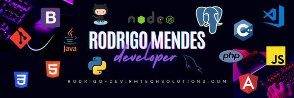

<h1 align="center">Olá! 👋 Eu sou o Rodrigo Mendes</h1>

  Engenheiro da Computação em formação • Desenvolvedor de Software iniciante, curioso e em constante evolução

  
  
  
  
  

  

  

---

### Sobre mim

- 💡 Gosto de transformar ideias em soluções simples e úteis
- 📚 Sempre aprendendo algo novo em desenvolvimento de software
- 🤝 Aberto a colaborar em projetos e aprender com a comunidade
- 🎯 Objetivo: evoluir como dev fullstack, construindo produtos de impacto

---

### Stack e Ferramentas

 
  
  
  
  
  
  
  
  
  
  

---

### O que você encontra por aqui

- Pequenos projetos e experimentos para praticar conceitos
- Estudos de base: lógica, algoritmos, estrutura de dados e orientação a objetos
- Explorações com back-end (Node.js, PHP, Python) e banco de dados (MySQL)

> "Sou apaixonado por tecnologias e gosto de aprender cada dia mais, com aqueles que, junto comigo, querem construir uma carreira de sucesso."

---

### Métricas e estatísticas

  
  
  

---

### Como posso ajudar

- Desenvolvimento de pequenas APIs e serviços
- Integrações simples com banco de dados
- Páginas estáticas e landing pages
- Refatoração e melhorias de legibilidade

Se tiver uma ideia legal, me chama! 😊

---

### Contatos

  
  
  
  
  

  Obrigado pela visita! 😇

